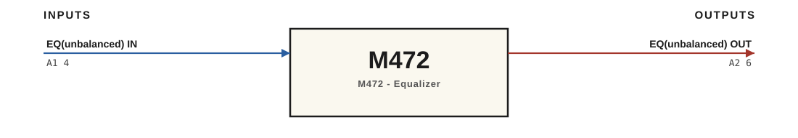

# M472 · RTO-144 Connections

M472 - Equalizer

## Audio connections

| Port | Signal | Dir | Pin + | Pin − |
|---|---|---|---|---|
| A1 | EQ(unbalanced) IN | in | 4 |  |
| A2 | EQ(unbalanced) OUT | out | 6 |  |

_Source: Module RTO-144 Jumper calculator.xlsx (Database tab). Verify against the module schematic before wiring._
