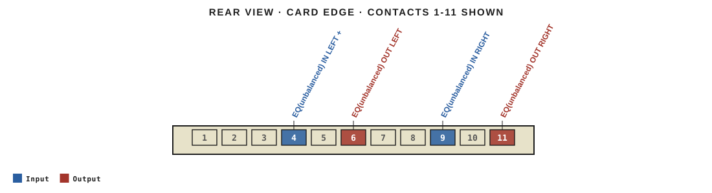
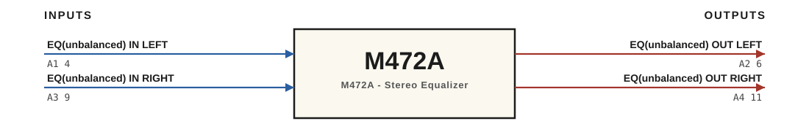

# M472A · RTO-144 Connections

M472A - Stereo Equalizer

## Audio connections

| Port | Signal | Dir | Pin + | Pin − |
|---|---|---|---|---|
| A1 | EQ(unbalanced) IN LEFT | in | 4 |  |
| A2 | EQ(unbalanced) OUT LEFT | out | 6 |  |
| A3 | EQ(unbalanced) IN RIGHT | in | 9 |  |
| A4 | EQ(unbalanced) OUT RIGHT | out | 11 |  |

_Source: Module RTO-144 Jumper calculator.xlsx (Database tab). Verify against the module schematic before wiring._
