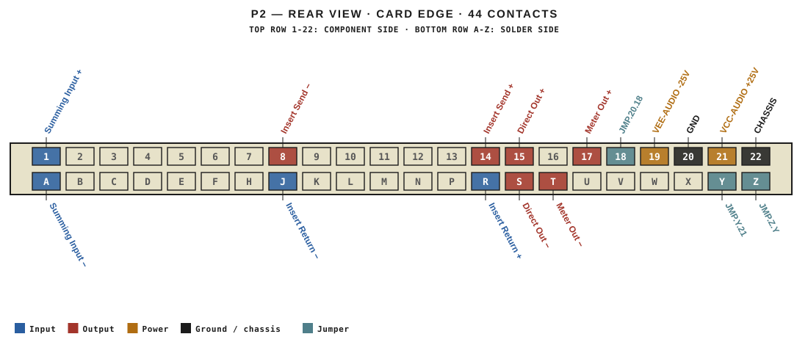
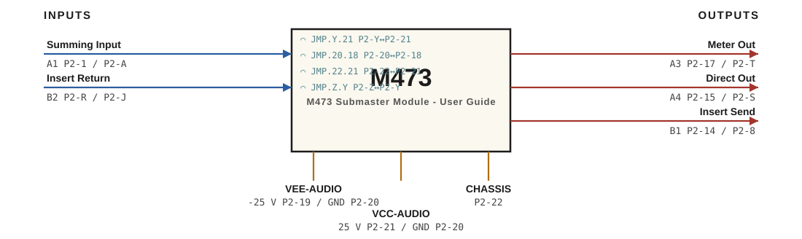

# M473 · RTO-144 Connections

M473 Submaster Module - User Guide

## Audio connections

| Port | Signal | Dir | Pin + | Pin − |
|---|---|---|---|---|
| A1 | Summing Input | in | P2-1 | P2-A |
| A3 | Meter Out | out | P2-17 | P2-T |
| A4 | Direct Out | out | P2-15 | P2-S |
| B1 | Insert Send | out | P2-14 | P2-8 |
| B2 | Insert Return | in | P2-R | P2-J |

## Power

| Rail | Volts | Max A | Supply | Ground |
|---|---|---|---|---|
| VEE-AUDIO | -25 | 0.1 | P2-19 | P2-20 |
| VCC-AUDIO | 25 | 0.2 | P2-21 | P2-20 |

## Jumpers

| Function | Designation | From | To |
|---|---|---|---|
| 24V Jumper | JMP.Y.21 | P2-Y | P2-21 |
| CH ON GND  | JMP.20.18 | P2-20 | P2-18 |
| Insert + | JMP.22.21 | P2-22 | P2-21 |
| Insert - | JMP.Z.Y | P2-Z | P2-Y |

_Source: Module RTO-144 Jumper calculator.xlsx (Database tab). Verify against the module schematic before wiring._
