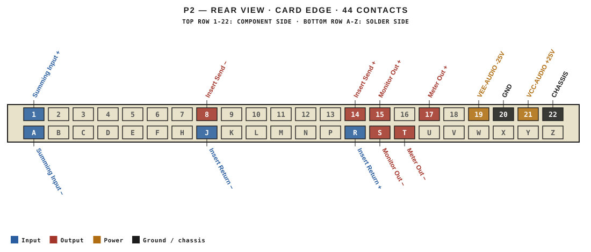
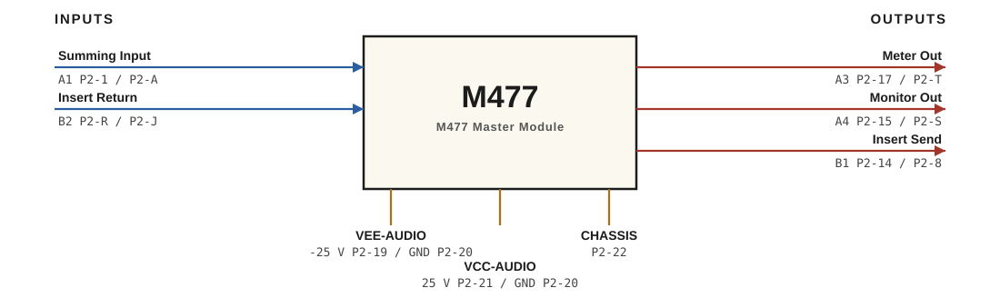

# M477 · RTO-144 Connections

M477 Master Module

## Audio connections

| Port | Signal | Dir | Pin + | Pin − |
|---|---|---|---|---|
| A1 | Summing Input | in | P2-1 | P2-A |
| A3 | Meter Out | out | P2-17 | P2-T |
| A4 | Monitor Out | out | P2-15 | P2-S |
| B1 | Insert Send | out | P2-14 | P2-8 |
| B2 | Insert Return | in | P2-R | P2-J |

## Power

| Rail | Volts | Max A | Supply | Ground |
|---|---|---|---|---|
| VEE-AUDIO | -25 | 0.1 | P2-19 | P2-20 |
| VCC-AUDIO | 25 | 0.2 | P2-21 | P2-20 |

_Source: Module RTO-144 Jumper calculator.xlsx (Database tab). Verify against the module schematic before wiring._
