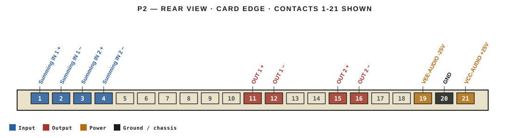
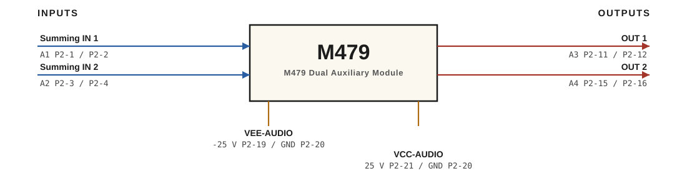

# M479 · RTO-144 Connections

M479 Dual Auxiliary Module

## Audio connections

| Port | Signal | Dir | Pin + | Pin − |
|---|---|---|---|---|
| A1 | Summing IN 1 | in | P2-1 | P2-2 |
| A2 | Summing IN 2 | in | P2-3 | P2-4 |
| A3 | OUT 1 | out | P2-11 | P2-12 |
| A4 | OUT 2 | out | P2-15 | P2-16 |

## Power

| Rail | Volts | Max A | Supply | Ground |
|---|---|---|---|---|
| VEE-AUDIO | -25 | 0.1 | P2-19 | P2-20 |
| VCC-AUDIO | 25 | 0.2 | P2-21 | P2-20 |

_Source: Module RTO-144 Jumper calculator.xlsx (Database tab). Verify against the module schematic before wiring._
