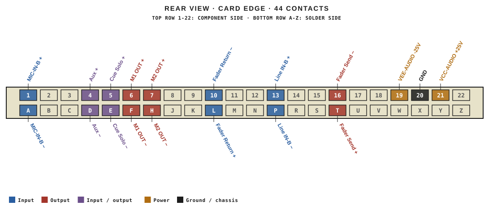
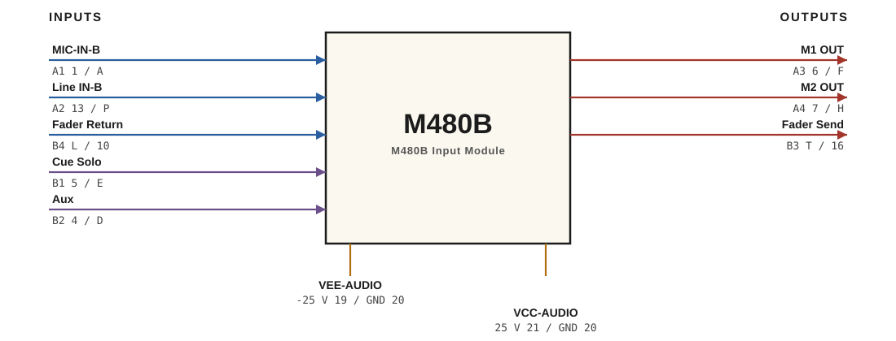

# M480B · RTO-144 Connections

M480B Input Module

## Audio connections

| Port | Signal | Dir | Pin + | Pin − |
|---|---|---|---|---|
| A1 | MIC-IN-B | in | 1 | A |
| A2 | Line IN-B | in | 13 | P |
| A3 | M1 OUT | out | 6 | F |
| A4 | M2 OUT | out | 7 | H |
| B1 | Cue Solo | io | 5 | E |
| B2 | Aux | io | 4 | D |
| B3 | Fader Send | out | T | 16 |
| B4 | Fader Return | in | L | 10 |

## Power

| Rail | Volts | Max A | Supply | Ground |
|---|---|---|---|---|
| VEE-AUDIO | -25 | 0.2 | 19 | 20 |
| VCC-AUDIO | 25 | 0.2 | 21 | 20 |

_Source: Module RTO-144 Jumper calculator.xlsx (Database tab). Verify against the module schematic before wiring._
