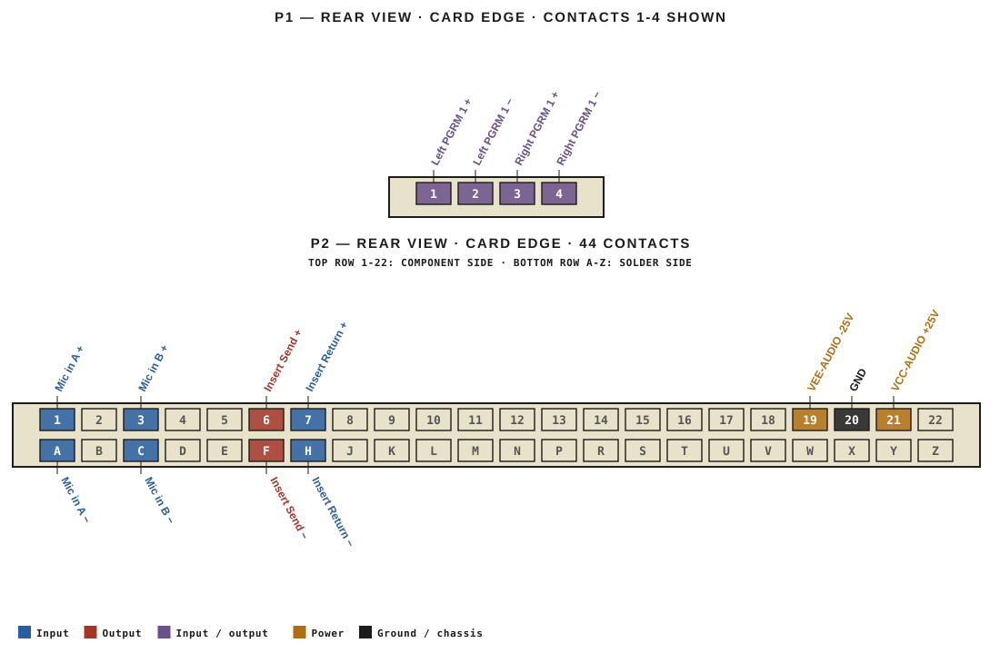
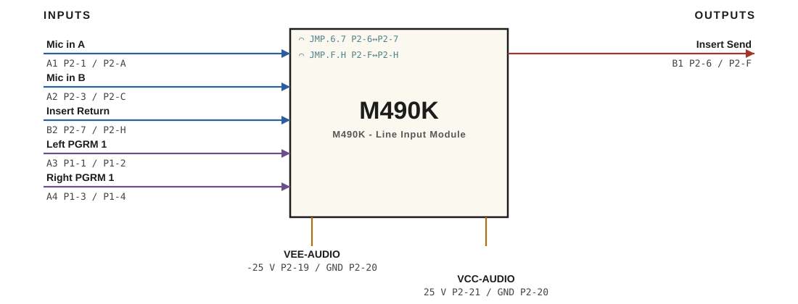

# M490K · RTO-144 Connections

M490K - Line Input Module

## Audio connections

| Port | Signal | Dir | Pin + | Pin − |
|---|---|---|---|---|
| A1 | Mic in A | in | P2-1 | P2-A |
| A2 | Mic in B | in | P2-3 | P2-C |
| A3 | Left PGRM 1 | io | P1-1 | P1-2 |
| A4 | Right PGRM 1 | io | P1-3 | P1-4 |
| B1 | Insert Send | out | P2-6 | P2-F |
| B2 | Insert Return | in | P2-7 | P2-H |

## Power

| Rail | Volts | Max A | Supply | Ground |
|---|---|---|---|---|
| VEE-AUDIO | -25 | 0.2 | P2-19 | P2-20 |
| VCC-AUDIO | 25 | 0.2 | P2-21 | P2-20 |

## Jumpers

| Function | Designation | From | To |
|---|---|---|---|
| Insert | JMP.6.7 | P2-6 | P2-7 |
| Insert | JMP.F.H | P2-F | P2-H |

_Source: Module RTO-144 Jumper calculator.xlsx (Database tab). Verify against the module schematic before wiring._
