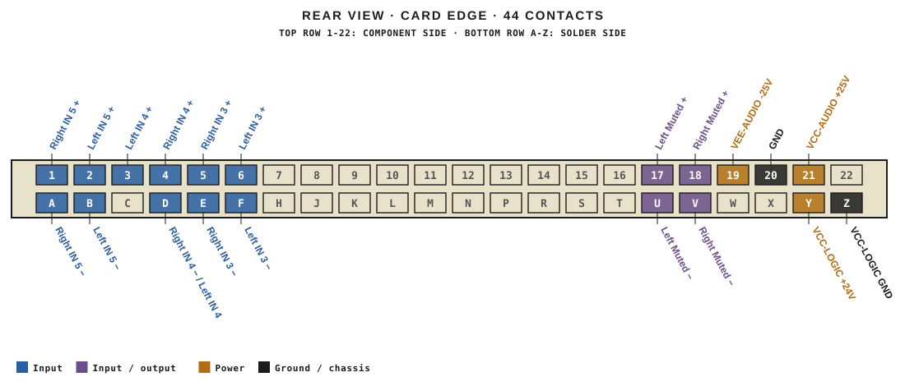
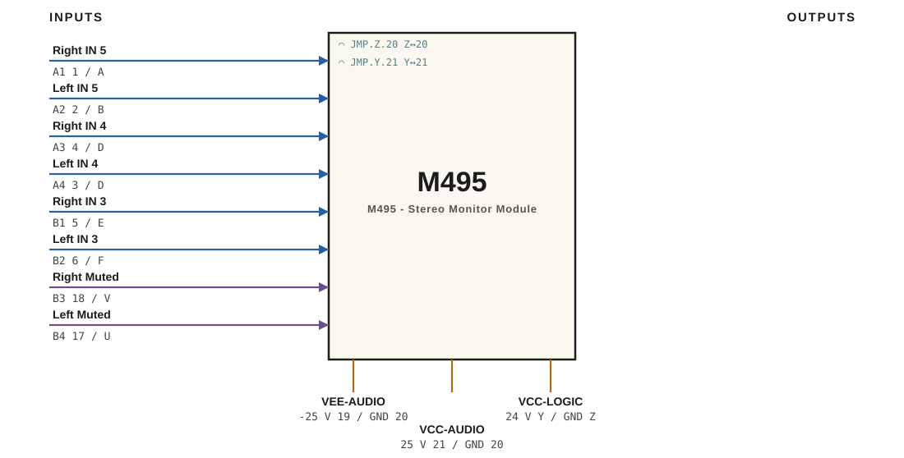

# M495 · RTO-144 Connections

M495 - Stereo Monitor Module

## Audio connections

| Port | Signal | Dir | Pin + | Pin − |
|---|---|---|---|---|
| A1 | Right IN 5 | in | 1 | A |
| A2 | Left IN 5 | in | 2 | B |
| A3 | Right IN 4 | in | 4 | D |
| A4 | Left IN 4 | in | 3 | D |
| B1 | Right IN 3 | in | 5 | E |
| B2 | Left IN 3 | in | 6 | F |
| B3 | Right Muted | io | 18 | V |
| B4 | Left Muted | io | 17 | U |

## Power

| Rail | Volts | Max A | Supply | Ground |
|---|---|---|---|---|
| VEE-AUDIO | -25 | 0.2 | 19 | 20 |
| VCC-AUDIO | 25 | 0.2 | 21 | 20 |
| VCC-LOGIC | 24 | 0.2 | Y | Z |

## Jumpers

| Function | Designation | From | To |
|---|---|---|---|
| CTRL COM | JMP.Z.20 | Z | 20 |
| 24V | JMP.Y.21 | Y | 21 |

_Source: Module RTO-144 Jumper calculator.xlsx (Database tab). Verify against the module schematic before wiring._
