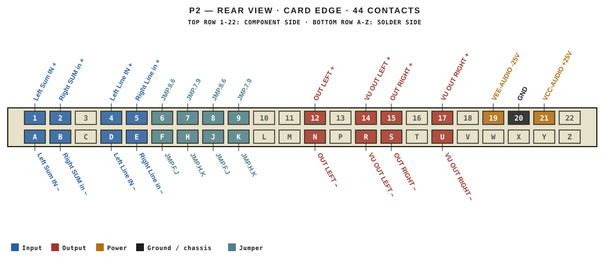
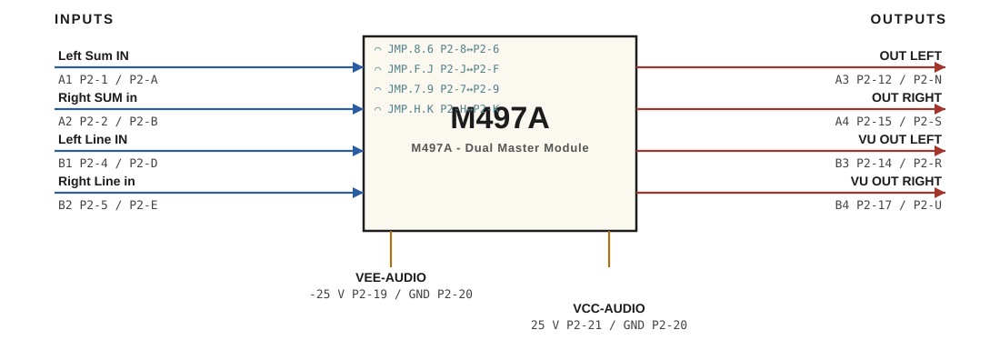

# M497A · RTO-144 Connections

M497A - Dual Master Module

## Audio connections

| Port | Signal | Dir | Pin + | Pin − |
|---|---|---|---|---|
| A1 | Left Sum IN | in | P2-1 | P2-A |
| A2 | Right SUM in | in | P2-2 | P2-B |
| A3 | OUT LEFT | out | P2-12 | P2-N |
| A4 | OUT RIGHT | out | P2-15 | P2-S |
| B1 | Left Line IN | in | P2-4 | P2-D |
| B2 | Right Line in | in | P2-5 | P2-E |
| B3 | VU OUT LEFT | out | P2-14 | P2-R |
| B4 | VU OUT RIGHT | out | P2-17 | P2-U |

## Power

| Rail | Volts | Max A | Supply | Ground |
|---|---|---|---|---|
| VEE-AUDIO | -25 | 0.2 | P2-19 | P2-20 |
| VCC-AUDIO | 25 | 0.2 | P2-21 | P2-20 |

## Jumpers

| Function | Designation | From | To |
|---|---|---|---|
| Insert LEFT + | JMP.8.6 | P2-8 | P2-6 |
| Insert LEFT - | JMP.F.J | P2-J | P2-F |
| Insert Right + | JMP.7.9 | P2-7 | P2-9 |
| Insert Right - | JMP.H.K | P2-H | P2-K |

_Source: Module RTO-144 Jumper calculator.xlsx (Database tab). Verify against the module schematic before wiring._
